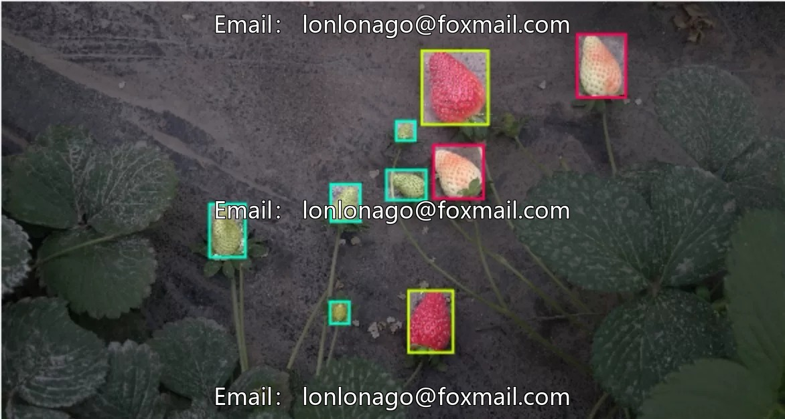
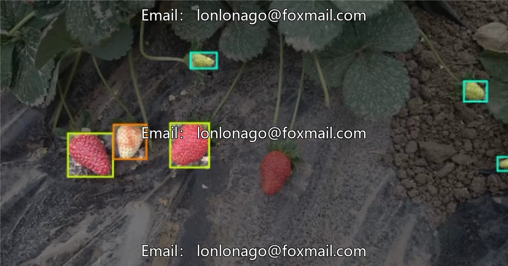
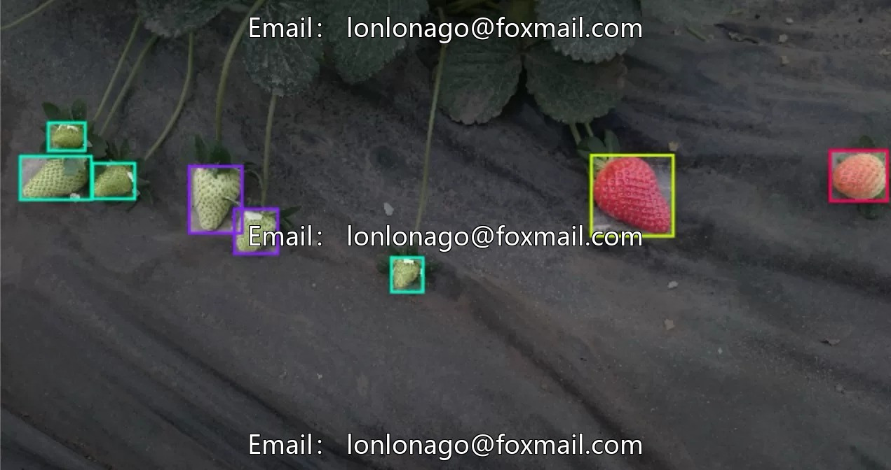

# Strawberry maturity recognition image dataset

## Body

Strawberry Maturity Recognition Image Dataset
Strawberry Growth Stage Identification, Strawberry Shoot Monitoring, Crop Maturity Recognition and Detection, YOLO dataset issue 10206

The dataset consists of 247 images, divided into 6 subcategories: Early Turning, Green, Late Turning, Red, Turning, White. It is suitable for training and testing of target detection models. The format is image files, which can be directly used in the development of computer vision models, supporting mainstream algorithms such as YOLO.

Virtual materials, once sold, are non-refundable.
Interested friends, click "I want" to proceed.

## Images

## Payment

Here is a pay link on Stripe ( https://buy.stripe.com/3cs8yP7sY87d0vu9AB ). Please contact me lonlonago@foxmail.com after funding $89, and I will send you a complete data files , thank you!

